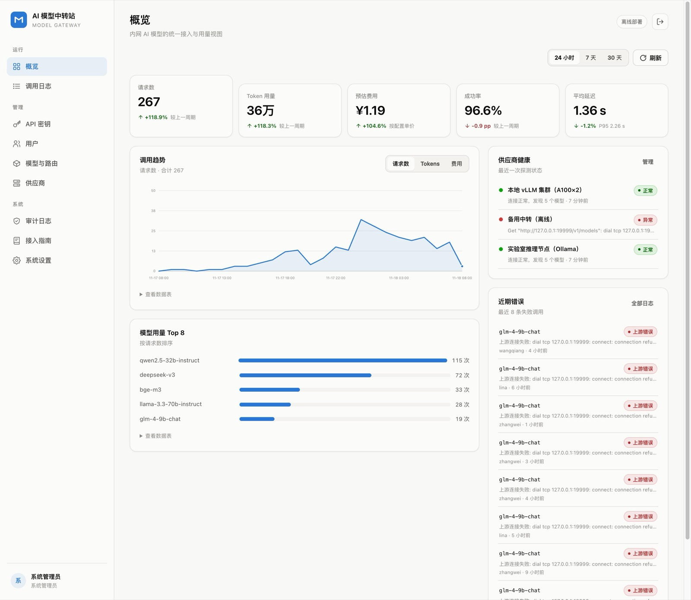
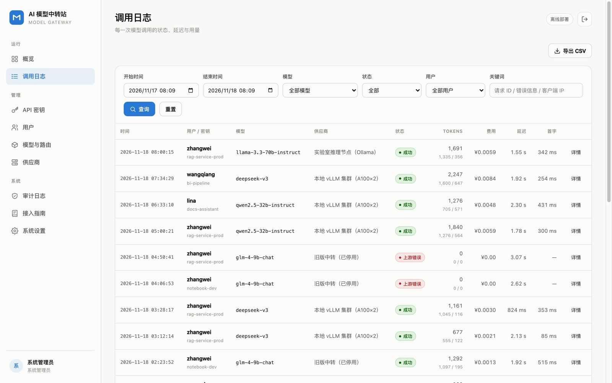
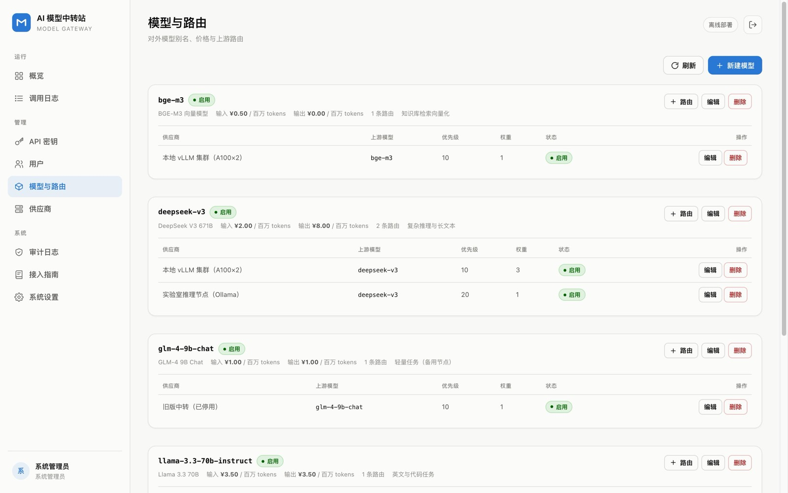
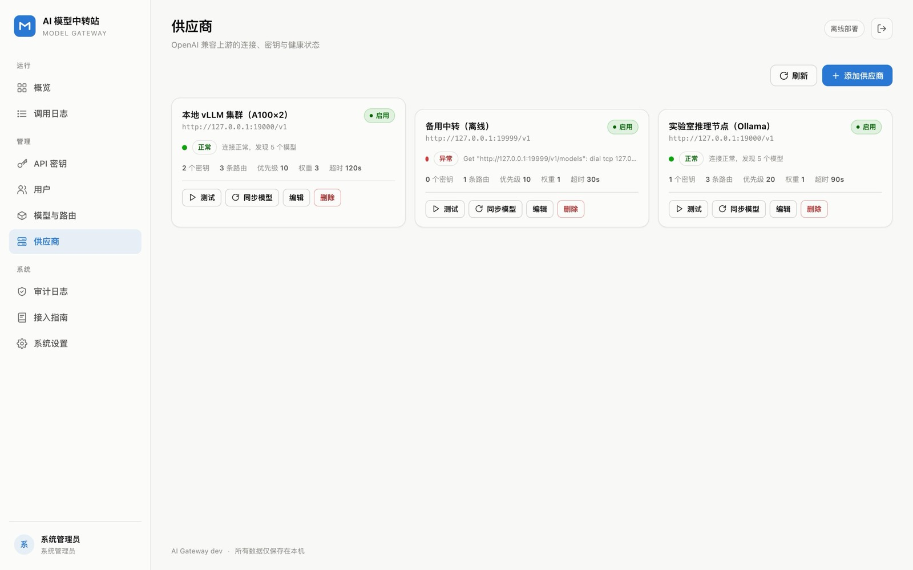
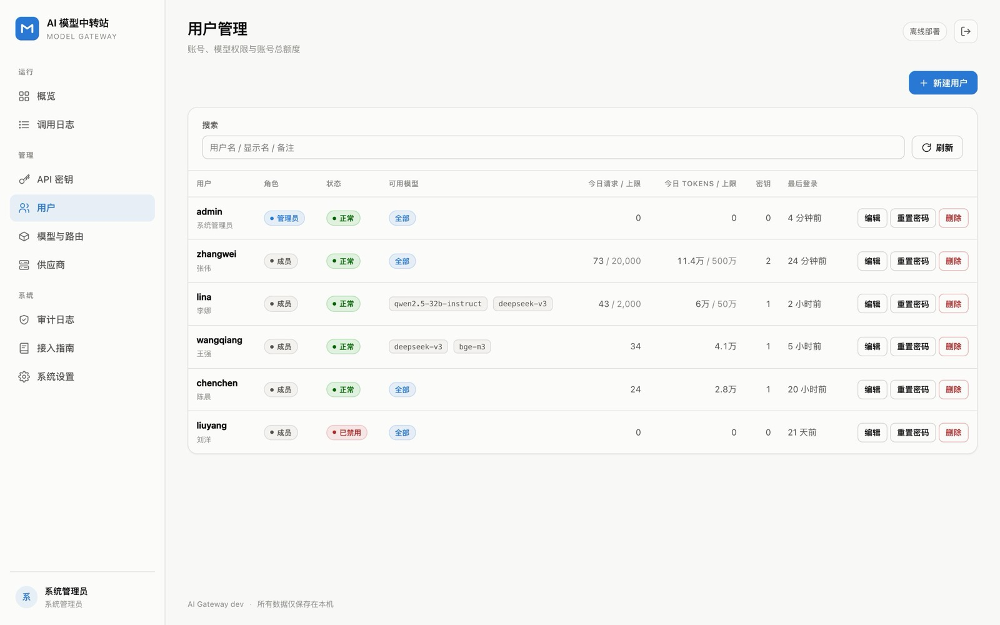
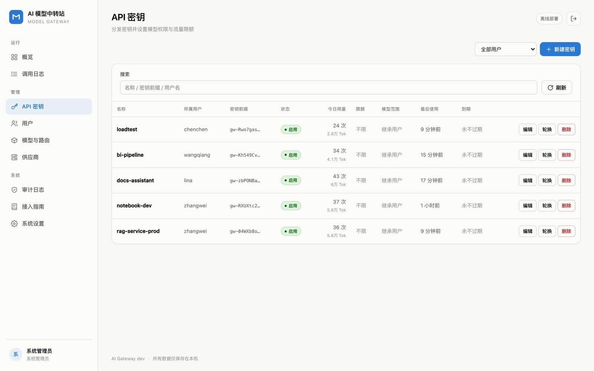
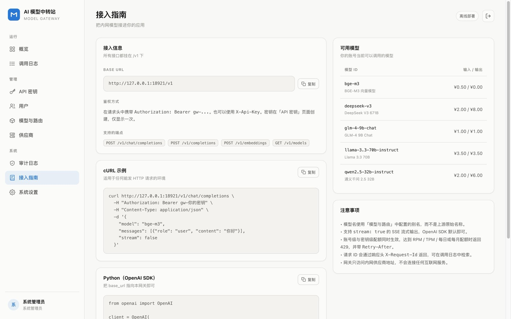
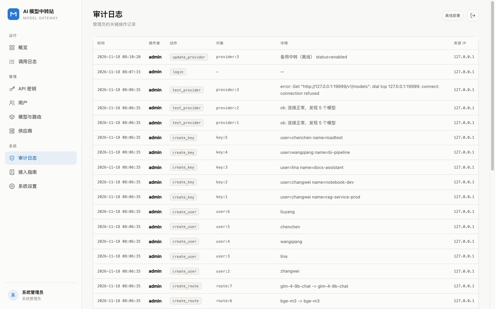
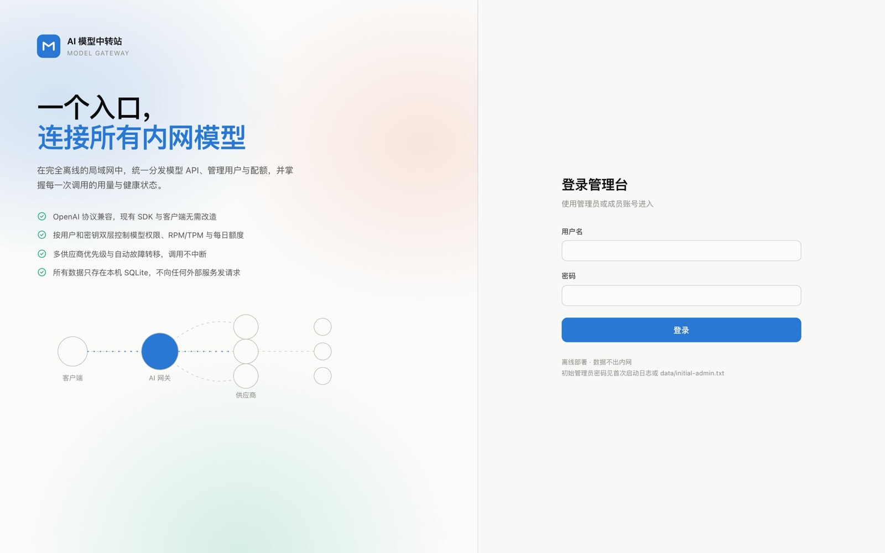

# AI Gateway · AI 模型中转站

面向**完全无互联网的局域网**的 AI 大模型 API Key 分发与中转网关。单个二进制、内嵌管理界面、纯 Go SQLite，不依赖 Docker、外部数据库、CDN 或任何在线服务。

> 设计参考 Magpie 的多供应商接入、优先级/权重调度与故障转移思路，但实现为轻量自研网关，专注于内网小规模（≤100 人）场景。

> **Windows 10 部署**：解压 `ai-gateway_1.0.0_windows_amd64.zip`，按 [WINDOWS.md](WINDOWS.md) 用一条 PowerShell 命令安装。无需 Docker/Go/Python/Node；Python/Node 只在调用模型时可选使用。

---

## 一、功能概览

| 需求 | 实现 |
|---|---|
| 用户管理 | 管理员/普通成员两种角色；创建、禁用、删除、重置密码；强制改密；登录会话 7 天可配置 |
| 流量管理 | 账号级与 Key 级双层配额（RPM、TPM、并发、每日请求、每日/每月 Token）；账号级是全部 Key 的合计上限，成员自建密钥也无法绕过；达到上限返回 429；用量按自然日/自然月统计 |
| 权限管理 | 用户级模型白名单；Key 级权限只能收窄、不能越权；模型别名支持精确匹配和前缀通配；Key 只存 SHA-256 哈希，明文仅创建时显示一次 |
| 供应商管理 | 任意 OpenAI 兼容上游；多上游 Key 轮换；优先级分组 + 组内加权随机；失败自动切换 Key/供应商；一键连通性测试；同步上游模型列表 |
| 接入可视化 | 24h/7d/30d 趋势、请求/Token/费用/成功率/延迟、模型与用户 Top、供应商健康、最近错误、请求日志筛选与 CSV 导出、审计日志 |
| 离线运行 | 前端资源全部内嵌；运行时只访问你配置的上游地址；无需联网、无外网字体/脚本 |

推理接口兼容 OpenAI 协议：

- `GET /v1/models`
- `POST /v1/chat/completions`（支持 SSE 流式）
- `POST /v1/completions`
- `POST /v1/embeddings`

管理界面默认地址：`http://<服务器IP>:8080`



> 概览：24 小时 / 7 天 / 30 天趋势、Token 与费用、成功率、供应商健康、模型用量 Top 与最近错误。

---

## 二、运行架构

```text
                   局域网（无互联网）
 ┌──────────┐      ┌──────────────────────────────────────┐      ┌─────────────────┐
 │ 用户 /   │      │            AI Gateway                │      │  OpenAI 兼容上游 │
 │ 业务系统 │─────▶│  :8080                               │─────▶│  vLLM / Ollama   │
 │ SDK/curl │ key  │  ├─ 鉴权（Key 哈希、状态、过期）      │      │  Xinference      │
 └──────────┘      │  ├─ 权限（用户/Key 模型白名单）       │      │  one-api ...     │
                   │  ├─ 配额（RPM/TPM/并发/日/月）        │      └─────────────────┘
 ┌──────────┐      │  ├─ 路由（别名 → 优先级/权重/故障转移）│
 │ 管理员   │─────▶│  ├─ 转发（流式透传、用量解析/估算）    │
 │ 浏览器   │ 会话 │  ├─ 记账（日志、每日用量、费用）       │
 └──────────┘      │  └─ 管理 API + 内嵌 Web UI           │
                   │                                      │
                   │  SQLite: gateway.db                   │
                   │  密钥保险箱: master.key (AES-256-GCM) │
                   └──────────────────────────────────────┘
```

请求处理顺序：API Key 鉴权 → Key 状态/过期 → 模型存在且启用 → 用户与 Key 的模型权限 → 日/月配额与限流 → 选择路由 → 上游失败转移 → 流式/非流式响应 → 记录日志与用量。

---

## 三、离线部署（Linux，无需 Docker）

### 3.1 准备安装包

在任意有 Go 环境的机器上构建（当前仓库已可直接构建）：

```bash
cd /path/to/网关
VERSION=1.0.0 ./scripts/build.sh
```

产物在 `dist/`：

```text
ai-gateway_1.0.0_linux_amd64.tar.gz    # 绝大多数 x86_64 服务器
ai-gateway_1.0.0_linux_arm64.tar.gz    # ARM64 服务器（鲲鹏/飞腾等）
ai-gateway_1.0.0_windows_amd64.zip     # Windows 机器
SHA256SUMS
```

二进制使用 `CGO_ENABLED=0` 静态编译，不依赖目标机器的 glibc 版本，也不需要安装 Go、Node、SQLite 或 Docker。

### 3.2 传入内网

通过 U 盘、光盘或内网跳板机把对应压缩包和 `SHA256SUMS` 拷入服务器，例如：

```bash
sha256sum -c SHA256SUMS
```

### 3.3 安装

```bash
mkdir -p /opt/ai-gateway-install
tar -xzf ai-gateway_1.0.0_linux_amd64.tar.gz -C /opt/ai-gateway-install
cd /opt/ai-gateway-install
sudo ./install.sh
```

常用参数：

```bash
sudo ./install.sh --port 9000
sudo ./install.sh --data-dir /data/ai-gateway --site-name "公司模型网关"
sudo ./install.sh --no-start        # 只安装不启动
```

脚本会完成：

1. 校验安装包架构与服务器一致；
2. 创建系统用户 `ai-gateway`（无登录 shell）；
3. 安装二进制到 `/usr/local/bin/ai-gateway`；
4. 生成 `/etc/ai-gateway/config.json`（已存在则保留）；
5. 创建数据目录 `/var/lib/ai-gateway`；
6. 写入并启用 systemd 服务 `ai-gateway.service`；
7. 启动并做健康检查，打印访问地址和首次登录密码。

> 没有 systemd 的老系统：脚本会自动跳过服务安装，并打印手动启动命令。也可以直接把二进制放到任意目录运行，见“十、配置”。

### 3.4 首次登录

安装结束会打印：

```text
首次登录凭据（登录后请立即改密并删除该文件）：
    username: admin
    password: <随机密码>
```

也可以查看：

```bash
sudo cat /var/lib/ai-gateway/initial-admin.txt
```

浏览器打开 `http://<服务器IP>:8080`，用该账号登录，进入“系统设置”修改密码，然后删除密码文件：

```bash
sudo rm -f /var/lib/ai-gateway/initial-admin.txt
```

### 3.5 放行防火墙

```bash
# firewalld
sudo firewall-cmd --permanent --add-port=8080/tcp && sudo firewall-cmd --reload

# ufw
sudo ufw allow 8080/tcp
```

云主机或交换机 ACL 也需放行对应端口。

### 3.6 可选：HTTPS 反向代理

网关本身可直接提供 HTTP。若内网有证书，可参考 `nginx.conf.example`：

```bash
sudo cp nginx.conf.example /etc/nginx/conf.d/ai-gateway.conf
sudo vi /etc/nginx/conf.d/ai-gateway.conf   # 修改域名与证书路径
sudo nginx -t && sudo systemctl reload nginx
```

通过代理访问时，把 `/etc/ai-gateway/config.json` 中的 `trust_proxy` 改为 `true` 并重启服务，日志才会记录真实客户端 IP。

### 3.7 演示：先在本机跑通一次调用

不想先装服务，可以起一个临时实例，几分钟走完整条链路：

```bash
# 启动：数据写到 ./data，管理界面在 8080
./ai-gateway -listen :8080 -data ./data

# 首次启动会打印初始管理员密码，同时保存在 data/initial-admin.txt
# 浏览器打开 http://127.0.0.1:8080，用 admin + 初始密码登录，并按提示修改密码
```

登录后依次完成三件事：

1. 「供应商」→「添加供应商」：填内网模型地址（如 `http://10.0.0.21:8000`），点「测试」确认连通；
2. 「模型与路由」→「新建模型」：别名填 `qwen2.5-32b-instruct`，再点「+ 路由」绑定供应商与上游真实模型名；
3. 「API 密钥」→「新建密钥」：选择用户并创建，明文密钥只在此时显示一次。

用拿到的密钥发起第一次调用：

```bash
curl http://127.0.0.1:8080/v1/chat/completions \
  -H "Authorization: Bearer gw-你的密钥" \
  -H "Content-Type: application/json" \
  -d '{"model":"qwen2.5-32b-instruct","messages":[{"role":"user","content":"你好"}],"stream":false}'
```

```json
{
  "id": "chatcmpl-9f2c1a",
  "object": "chat.completion",
  "created": 1763510400,
  "model": "qwen2.5-32b-instruct",
  "choices": [{
    "index": 0,
    "finish_reason": "stop",
    "message": { "role": "assistant", "content": "你好！有什么可以帮你的？" }
  }],
  "usage": { "prompt_tokens": 12, "completion_tokens": 9, "total_tokens": 21 }
}
```

切回「概览」，这次调用立即出现在趋势图、模型用量和「调用日志」中；多调几次就能看到成功率、平均延迟与预估费用。

---

## 四、管理员配置流程（建议顺序）

### 1. 添加供应商

进入“供应商”→“添加供应商”：

| 字段 | 说明 | 示例 |
|---|---|---|
| 名称 | 自定义，便于识别 | `GPU-01 vLLM` |
| Base URL | 上游根地址，推荐不带 `/v1`（带了也能识别） | `http://10.0.0.21:8000` |
| API Keys | 上游密钥，一行一个；无鉴权可留空 | `sk-xxx` |
| 超时 | 秒，默认 120 | `120` |
| 优先级 | 数字越小越优先 | `1` |
| 权重 | 同优先级内按权重随机 | `3` |
| 状态 | 启用/停用 | `启用` |

保存后点“测试连接”：网关会请求上游 `GET {base_url}/v1/models`，成功时显示模型数量；可点“同步模型”把上游模型列表拉入本地，创建路由时可直接选择。

### 2. 创建模型别名与路由

进入“模型与路由”→“添加模型”：

1. 定义**对外暴露的模型名**（别名），例如 `qwen2.5-7b`、`deepseek-v3`；
2. 设置输入/输出价格（元/百万 tokens，仅用于费用估算，可填 0）；
3. 在模型卡片中添加路由：选择供应商、填写**上游真实模型名**、优先级与权重。

同一别名可添加多条路由，实现多供应商冗余：

```text
别名 qwen2.5-7b
  ├─ 路由 A：供应商 GPU-01，上游 qwen2.5-7b-instruct，优先级 1，权重 3
  ├─ 路由 B：供应商 GPU-02，上游 qwen2.5-7b-instruct，优先级 1，权重 1
  └─ 路由 C：供应商 备用集群，上游 qwen2.5-7b，优先级 2，权重 1
```

调度规则：

- 先按路由优先级升序；
- 同一优先级内按权重随机打乱；
- 当前路由失败（网络错误、401/403、404、429、5xx 等）时，依次尝试该路由的多个上游 Key，再切到下一条路由；
- 客户端只看到最终结果，日志中记录重试次数与实际命中的供应商。

### 3. 创建用户

进入“用户管理”→“添加用户”：

- 用户名：3–64 位字母、数字、`_`、`.`、`-`；
- 角色：`admin`（可管理全部资源）或 `user`（仅能管理自己的 Key、查看自己的日志）；
- 可用模型：`*` 表示全部；`qwen2.5-7b` 表示单个；`qwen2.5*` 表示前缀匹配；多个用逗号分隔；
- 账号级限额：RPM、TPM、并发、每日请求、每日 Token、每月 Token，作用于该用户全部 Key 的合计用量；
- 状态：禁用后立即无法登录，已有会话失效。

### 4. 分发 API Key

进入“API 密钥”→选择用户→“创建密钥”：

- 模型范围留空表示继承用户权限；填写后只能进一步收窄；
- 配额均为 0 时表示不限；
- 支持设置过期时间、禁用、轮换和删除。

**明文 Key 只在创建/轮换成功时显示一次**，请当场复制给用户。数据库只保存哈希和前缀，管理员之后也无法查看完整 Key。

### 5. 验证

用新 Key 测试：

```bash
curl http://127.0.0.1:8080/v1/models \
  -H "Authorization: Bearer gw-xxxxxxxx"

curl http://127.0.0.1:8080/v1/chat/completions \
  -H "Authorization: Bearer gw-xxxxxxxx" \
  -H "Content-Type: application/json" \
  -d '{"model":"qwen2.5-7b","messages":[{"role":"user","content":"你好"}]}'
```

成功后，“概览”和“调用日志”会立即出现数据。

---

## 五、客户端接入

把 `base_url` 指向网关、`api_key` 换成网关分发的 Key 即可，模型名使用网关中的**别名**。

### curl

```bash
curl http://10.0.0.10:8080/v1/chat/completions \
  -H "Authorization: Bearer gw-xxxxxxxx" \
  -H "Content-Type: application/json" \
  -d '{
    "model": "qwen2.5-7b",
    "messages": [{"role": "user", "content": "用一句话介绍自己"}],
    "stream": true
  }'
```

### Python（openai SDK）

```python
from openai import OpenAI

client = OpenAI(
    base_url="http://10.0.0.10:8080/v1",
    api_key="gw-xxxxxxxx",
)
resp = client.chat.completions.create(
    model="qwen2.5-7b",
    messages=[{"role": "user", "content": "你好"}],
)
print(resp.choices[0].message.content)
```

### Node.js（openai SDK）

```js
import OpenAI from "openai";

const client = new OpenAI({
  baseURL: "http://10.0.0.10:8080/v1",
  apiKey: "gw-xxxxxxxx",
});

const resp = await client.chat.completions.create({
  model: "qwen2.5-7b",
  messages: [{ role: "user", content: "你好" }],
});
console.log(resp.choices[0].message.content);
```

### 使用环境变量（适配大量现成工具）

```bash
export OPENAI_BASE_URL=http://10.0.0.10:8080/v1
export OPENAI_API_KEY=gw-xxxxxxxx
```

许多 OpenAI 兼容客户端（Cherry Studio、Chatbox、Open WebUI、Dify、LangChain、LlamaIndex 等）只需在设置中填写：

- API Base / Base URL：`http://10.0.0.10:8080/v1`
- API Key：`gw-xxxxxxxx`
- 模型：网关中的别名（可先在 `/v1/models` 中看到自己有权限的列表）

> 客户端若强制要求 HTTPS，请配置反向代理；网关自身不做 TLS 终止。

---

## 六、流量与配额

配额分两层，同时校验，任意一层超限都会返回 429：

1. **用户级（账号总上限）**：该用户名下所有 API Key 的合计用量。成员即使自助新建密钥，也无法绕过账号总额度；
2. **Key 级（应用级上限）**：单个 Key 的限额，只能在用户额度内进一步收紧，便于给不同应用分别限流。

| 配额 | 字段 | 行为 |
|---|---|---|
| 每分钟请求数 | RPM | 滑动 60 秒窗口，超出返回 429 `rpm_limit` / `user_rpm_limit` |
| 每分钟 Token | TPM | 按最近 60 秒已用 Token 计算，超出返回 429 `tpm_limit` / `user_tpm_limit` |
| 并发请求 | 并发数 | 同时处理的请求数，超出返回 429 `concurrency_limit` / `user_concurrency_limit` |
| 每日请求 | 每日请求上限 | 按服务器本地自然日统计，超出返回 429 `daily_request_limit` / `user_daily_request_limit` |
| 每日 Token | 每日 Token 上限 | 自然日重置，超出返回 429 `daily_token_limit` / `user_daily_token_limit` |
| 每月 Token | 每月 Token 上限 | 自然月重置，超出返回 429 `monthly_token_limit` / `user_monthly_token_limit` |

说明：

- `0` 表示不限制；两层都填 0 才是真正不限；
- 日/月用量来自成功请求的记账（`usage_daily`），按用户和 Key 分别累计；删除 Key 不会抹掉账号已用量，拒绝请求只记日志、不增加配额；
- 429 响应带 `Retry-After` 头，便于客户端退避；
- RPM/TPM/并发是进程内滑动窗口，服务重启后清零；日/月配额写入数据库，重启不会丢失；
- 每日边界依赖服务器时区。需要按北京时间切分时，先执行 `sudo timedatectl set-timezone Asia/Shanghai` 再启动服务；
- 费用 = 输入 Token × 输入单价 + 输出 Token × 输出单价，单位为元，仅用于内部估算，不涉及真实扣费；
- 上游返回 `usage` 时按上游数值记账；流式响应默认自动请求 `stream_options.include_usage`，若上游不支持则无感重试；仍未返回时按文本长度估算（英文约 4 字符≈1 token，中文约 1.5 字≈1 token），日志仍可用但计费为近似值。

---

## 七、权限模型

```text
管理员 admin
  ├─ 用户、供应商、模型路由、全部 Key、全部日志、系统设置、审计日志
  ├─ 可设置用户级总额度，以及每个 Key 的独立额度
  └─ 自身也通过 API Key 调用模型

普通成员 user
  ├─ 登录后仅能创建/修改/删除自己的 Key（合计用量受账号级限额约束）
  ├─ 只能查看自己的调用日志
  └─ 可查看自己被授权的模型与接入指南；不能进入管理页面
```

模型访问需要同时满足：

1. Key 状态为启用且未过期；
2. 用户状态为启用；
3. 请求的模型别名已启用；
4. 模型在**用户**的可用模型列表中（`*` / 精确 / 前缀通配）；
5. 若 Key 配置了模型范围，还必须在该范围内（Key 只能收窄权限）。

其他安全设计：

- 密码使用 PBKDF2-HMAC-SHA256（210,000 次迭代）加盐存储；
- 会话使用随机 Token，数据库只存哈希，Cookie 为 `HttpOnly` + `SameSite=Lax`；
- 管理端写操作校验 `X-Requested-With` 与 `Origin`，防 CSRF；
- 上游供应商密钥使用 AES-256-GCM 加密后写入数据库，主密钥单独保存在 `master.key`；
- 页面启用 CSP、`X-Frame-Options: DENY`、`nosniff` 等安全头；
- API Key 在访问日志中不会出现，日志只记录方法、路径、状态码、耗时与 IP。

---

## 八、供应商接入示例

Base URL 一律填**根地址**，网关会自动拼接 `/v1/chat/completions` 等路径。

| 上游 | Base URL 示例 | 密钥 |
|---|---|---|
| vLLM | `http://10.0.0.21:8000` | 启动参数 `--api-key` 有则填写，否则留空 |
| Ollama | `http://10.0.0.22:11434` | 留空 |
| Xinference | `http://10.0.0.23:9997` | 按部署配置 |
| LM Studio | `http://10.0.0.24:1234` | 留空 |
| one-api / new-api | `http://10.0.0.25:3000` | 其生成的上游 Key |
| 其他 OpenAI 兼容服务 | 以其文档为准 | 按文档 |

注意：

- 若上游地址本身带路径前缀（例如 `http://host:8000/api`），网关会保留该前缀并追加 `/v1/...`；
- 上游若是 HTTPS 且使用内网自签证书，网关默认会校验失败。此时应把 CA 证书安装到系统信任库，而不是关闭校验；
- “测试连接”请求的是 `{base_url}/v1/models`，个别上游不支持该接口时会显示失败，但不影响实际对话转发，可用真实请求验证。

---

## 九、可视化与日志

“概览”页面：

- 24 小时 / 7 天 / 30 天切换；
- 请求数、Token、费用、成功率、平均/P95 延迟；
- 趋势图（可切换指标、悬停查看数值、切换表格视图）；
- 模型、用户、供应商 Top 榜；
- 供应商健康状态与最近错误。

“调用日志”页面：

- 按时间、用户、Key、模型、成功/失败、关键词筛选；
- 展示请求 ID、上游模型、供应商、状态码、Token、费用、延迟、首字时间、重试次数、客户端 IP；
- 支持导出 CSV（UTF-8 BOM，Excel 可直接打开，最多 2 万条）。

“审计日志”记录登录失败、用户/Key/供应商/模型/设置的变更操作。

普通成员只能看到自己的日志和自己的 Key。

### 界面预览

以下截图来自一套演示数据（3 个供应商、5 个模型、5 个用户）。

<table>
  <tr>
    <td width="50%"></td>
    <td width="50%"></td>
  </tr>
  <tr>
    <td></td>
    <td></td>
  </tr>
  <tr>
    <td></td>
    <td></td>
  </tr>
  <tr>
    <td></td>
    <td></td>
  </tr>
</table>

---

## 十、配置

### 配置文件

默认路径 `/etc/ai-gateway/config.json`：

```json
{
  "listen": ":8080",
  "data_dir": "/var/lib/ai-gateway",
  "site_name": "AI 模型中转站",
  "trust_proxy": false,
  "session_ttl_hours": 168,
  "log_file": ""
}
```

| 字段 | 说明 |
|---|---|
| `listen` | 监听地址。`:8080` 表示所有网卡；只允许本机访问可写 `127.0.0.1:8080` |
| `data_dir` | 数据目录，存放数据库、主密钥、初始密码文件 |
| `site_name` | 站点名称，首次启动写入数据库，之后可在“系统设置”修改 |
| `trust_proxy` | 是否信任 `X-Forwarded-For`；仅当网关前面有可信反向代理时开启 |
| `session_ttl_hours` | 登录会话有效期，默认 168 小时（7 天） |
| `log_file` | 可选。日志文件路径；为空时输出到控制台。超过 20 MB 时启动会轮换为 `.1` |

### 环境变量（优先级高于配置文件）

| 变量 | 说明 |
|---|---|
| `GATEWAY_LISTEN` | 监听地址 |
| `GATEWAY_DATA_DIR` | 数据目录 |
| `GATEWAY_SITE_NAME` | 站点名称（仅首次初始化生效） |
| `GATEWAY_TRUST_PROXY` | `1`/`true` 开启 |
| `GATEWAY_SESSION_TTL_HOURS` | 会话有效期 |
| `GATEWAY_LOG_LEVEL` | `debug` / `info` / `warn` / `error` |
| `GATEWAY_LOG_FILE` | 日志文件路径（可选） |
| `GATEWAY_ADMIN_USERNAME` | 首次启动创建的管理员用户名，默认 `admin` |
| `GATEWAY_ADMIN_PASSWORD` | 首次启动的管理员密码；不设置则随机生成并写入文件 |
| `GATEWAY_RESET_PASSWORD` | 配合 `-reset-password-for` 使用，见“十一、运维” |

### 命令行参数

```bash
ai-gateway -config /etc/ai-gateway/config.json
ai-gateway -listen :8080 -data /var/lib/ai-gateway
ai-gateway -config config.json -log logs/gateway.log
ai-gateway -version
```

参数优先级：命令行 > 环境变量 > 配置文件 > 默认值。

### 无 systemd / 手动运行

```bash
sudo -u ai-gateway /usr/local/bin/ai-gateway -config /etc/ai-gateway/config.json
```

或前台快速试用：

```bash
mkdir -p ./data
./ai-gateway -listen :8080 -data ./data
```

Windows 10 推荐使用安装脚本（开机自启、日志、防火墙、目录权限一次完成）：

```powershell
cd C:\ai-gateway
powershell -ExecutionPolicy Bypass -File .\install-windows.ps1
```

完整说明见 [WINDOWS.md](WINDOWS.md)。

仅临时试用时，也可双击 `run-windows.bat`，或在前台运行：

```powershell
.\ai-gateway.exe -listen :8080 -data .\data -log .\data\gateway.log
```

首次启动会在控制台打印管理员密码，并保存到 `data\initial-admin.txt`。手动运行时需要自行放行防火墙：

```powershell
netsh advfirewall firewall add rule name="AI Gateway 8080" dir=in action=allow protocol=TCP localport=8080
```

---

## 十一、运维

### 服务管理

```bash
systemctl status ai-gateway
systemctl restart ai-gateway
systemctl stop ai-gateway
journalctl -u ai-gateway -f
```

### 备份（重要）

必须同时备份数据库和主密钥，否则供应商 Key 无法解密：

```bash
sudo systemctl stop ai-gateway
sudo tar -czf /backup/ai-gateway-$(date +%F).tar.gz \
  -C /var/lib/ai-gateway gateway.db master.key
sudo systemctl start ai-gateway
```

WAL 模式下请在停服务后备份，或连同 `gateway.db-wal`、`gateway.db-shm` 一起复制。建议每天定时备份到另一台机器。

### 恢复

```bash
sudo systemctl stop ai-gateway
sudo tar -xzf /backup/ai-gateway-2026-11-15.tar.gz -C /var/lib/ai-gateway
sudo chown ai-gateway:ai-gateway /var/lib/ai-gateway/gateway.db /var/lib/ai-gateway/master.key
sudo systemctl start ai-gateway
```

### 升级

把新版本安装包解压到新目录，执行同一个 `install.sh` 即可。脚本会停服务、替换二进制、保留配置与数据、重新启动：

```bash
tar -xzf ai-gateway_1.0.1_linux_amd64.tar.gz -C /opt/ai-gateway-1.0.1
cd /opt/ai-gateway-1.0.1 && sudo ./install.sh
```

回滚：保留旧版二进制，停服务后覆盖 `/usr/local/bin/ai-gateway` 再启动。数据库结构向后兼容，但跨大版本升级前请先备份。

### 忘记管理员密码

在服务器本机执行（需要数据目录访问权限）：

```bash
sudo systemctl stop ai-gateway
sudo -u ai-gateway env GATEWAY_RESET_PASSWORD='新密码至少8位' \
  /usr/local/bin/ai-gateway -config /etc/ai-gateway/config.json \
  -reset-password-for admin
sudo systemctl start ai-gateway
```

该用户的所有登录会话会立即失效。

### 日志保留

- 请求日志默认保留 90 天，可在“系统设置”修改；
- 每日用量数据保留约 13 个月（用于月度统计）；
- 清理任务每小时执行一次；修改保留天数后无需重启。

### 数据文件

```text
/var/lib/ai-gateway/
├── gateway.db          # 用户、Key、供应商、模型、日志、用量、审计
├── gateway.db-wal      # SQLite WAL
├── gateway.db-shm
├── master.key          # AES-256 主密钥（0600，丢失后供应商密钥不可恢复）
└── initial-admin.txt   # 首次生成的密码，登录后请删除
```

### 卸载

```bash
sudo systemctl disable --now ai-gateway
sudo rm -f /etc/systemd/system/ai-gateway.service
sudo systemctl daemon-reload
sudo rm -f /usr/local/bin/ai-gateway
sudo rm -rf /etc/ai-gateway
# 确认不再需要数据后再删除：
# sudo rm -rf /var/lib/ai-gateway
```

---

## 十二、安全建议

1. **立即修改初始密码**并删除 `initial-admin.txt`；
2. `master.key` 权限保持 `0600`，不要与数据库放在可公开访问的目录，不要提交到代码仓库；
3. 网关默认以非 root 用户运行；不要用 root 直接启动；
4. 只在可信内网开放端口，尽量用防火墙限制来源网段；
5. 有条件的部署 HTTPS 反向代理，避免 API Key 明文经过网络；
6. 不要开启 `trust_proxy`，除非网关确实位于可信代理之后；
7. 为不同应用创建不同 Key，便于单独禁用、轮换和限额；
8. 定期检查“审计日志”和失败请求，发现异常 Key 立即禁用；
9. 上游供应商密钥建议使用最小权限、可单独吊销的 Key；
10. 备份文件包含主密钥，按敏感数据保管。

---

## 十三、故障排查

| 现象 | 排查 |
|---|---|
| 浏览器打不开 | `systemctl status ai-gateway`；确认监听地址与端口；检查防火墙/ACL；`curl http://127.0.0.1:8080/healthz` |
| 登录提示用户名或密码错误 | 确认账号状态；管理员可在用户管理重置；全部管理员锁死时用“忘记管理员密码”流程 |
| 401 `缺少 API Key` / `API Key 无效` | 检查 `Authorization: Bearer gw-...`；确认 Key 未被删除、禁用或轮换 |
| 403 `无权访问模型` | 检查用户的可用模型、Key 的模型范围、模型别名是否启用 |
| 403 `用户已被禁用` / `Key 已过期` | 管理员启用用户或延长 Key 有效期 |
| 404 `模型不存在或未启用` | 模型别名拼写；是否已在“模型与路由”中启用 |
| 429 | 看响应中的 `error.code`：带 `user_` 前缀表示账号总额度用完，否则是 Key 级额度；调整用户或 Key 配额，或等待重置 |
| 502 `所有上游均不可用` | 供应商“测试连接”；检查 Base URL、网络连通性、上游 Key、上游服务日志 |
| 503 `暂无可用供应商` | 模型没有启用中的路由，或路由指向的供应商被停用 |
| 流式输出卡住/一次性返回 | 反向代理需关闭缓冲并放宽超时，参考 `nginx.conf.example` |
| Token 数与上游不一致 | 上游未返回 usage 时为估算值；可让上游开启 usage 统计 |
| 费用为 0 | 模型价格未配置；在“模型与路由”中填写单价 |
| 时间/日配额边界不对 | 设置服务器时区：`timedatectl set-timezone Asia/Shanghai`，然后重启服务 |
| 升级后页面仍旧 | 强制刷新浏览器；静态资源已设置 `no-cache`，正常刷新即可 |

查看服务日志：

```bash
journalctl -u ai-gateway -n 200 --no-pager
```

---

## 十四、开发与构建

要求 Go 1.27.4+（与 `go.mod` 一致；当前使用 Go 1.27.4 验证）。二进制已提供，目标服务器无需安装 Go。

```bash
go test ./...
go build -o bin/ai-gateway .
go run . -listen :8080 -data ./data
```

构建离线发布包：

```bash
VERSION=1.0.0 ./scripts/build.sh
SKIP_TESTS=1 VERSION=1.0.0 ./scripts/build.sh   # 跳过测试
BUILD_DARWIN=1 VERSION=1.0.0 ./scripts/build.sh # 额外生成本机 macOS 试用二进制
```

目录结构：

```text
.
├── main.go                     # 启动、配置、初始管理员、后台维护
├── internal/
│   ├── gateway/                # 代理、路由、故障转移、SSE、用量解析
│   ├── httpapi/                # 管理 API、鉴权、中间件、内嵌 Web UI
│   │   └── web/                # index.html / app.js / styles.css
│   ├── limiter/                # RPM/TPM/并发/登录限流
│   ├── secure/                 # 密码、Token、AES 保险箱
│   └── store/                  # SQLite 数据访问
├── deploy/                     # systemd、安装脚本、配置与 Nginx 样例
├── scripts/build.sh            # 离线发布包构建
└── README.md
```

数据库使用纯 Go 的 `modernc.org/sqlite`，因此可静态交叉编译，无需 CGO。

---

## 十五、已知限制

- 单实例部署：SQLite 与内存限流适合 ≤100 人；多实例需要外部数据库与共享限流，当前不支持；
- 只做 OpenAI 协议入口与出口，不转换 Anthropic `/v1/messages`、Gemini 等协议；图片、音频、`/v1/responses` 暂未转发；
- 费用为按 Token 的估算，不含缓存折扣、阶梯价或真实账单；
- 上游未返回 usage 时 Token 为估算值；
- 没有在线支付、充值、余额体系；配额以请求数/Token 计；
- 管理界面为中文，未做多语言。

---

## 附：主要接口

管理端（需登录 Cookie）：

```text
POST   /api/auth/login
POST   /api/auth/logout
GET    /api/auth/me
POST   /api/auth/password
GET    /api/keys
POST   /api/keys
PATCH  /api/keys/{id}
DELETE /api/keys/{id}
POST   /api/keys/{id}/rotate
GET    /api/logs
GET    /api/my/models
GET    /api/admin/users
POST   /api/admin/users
PATCH  /api/admin/users/{id}
DELETE /api/admin/users/{id}
POST   /api/admin/users/{id}/password
GET    /api/admin/providers
POST   /api/admin/providers
PATCH  /api/admin/providers/{id}
DELETE /api/admin/providers/{id}
POST   /api/admin/providers/{id}/test
POST   /api/admin/providers/{id}/sync-models
GET    /api/admin/models
POST   /api/admin/models
PATCH  /api/admin/models/{alias}
DELETE /api/admin/models/{alias}
POST   /api/admin/routes
PATCH  /api/admin/routes/{id}
DELETE /api/admin/routes/{id}
GET    /api/admin/stats/overview
GET    /api/admin/logs/export
GET    /api/admin/audit
GET    /api/admin/settings
PATCH  /api/admin/settings
GET    /api/admin/system
```

推理端（需 `Authorization: Bearer gw-...`）：

```text
GET    /v1/models
POST   /v1/chat/completions
POST   /v1/completions
POST   /v1/embeddings
```

健康检查：

```text
GET /healthz
GET /api/meta
```
